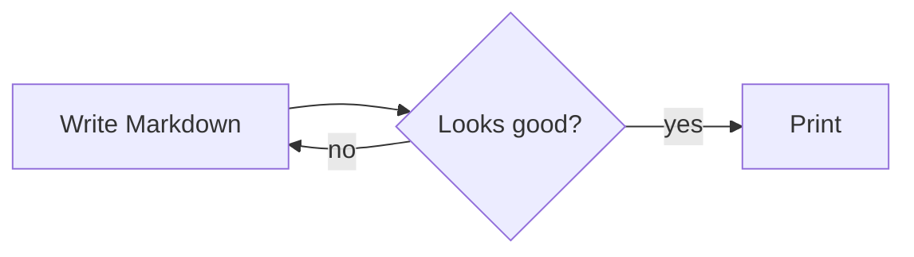
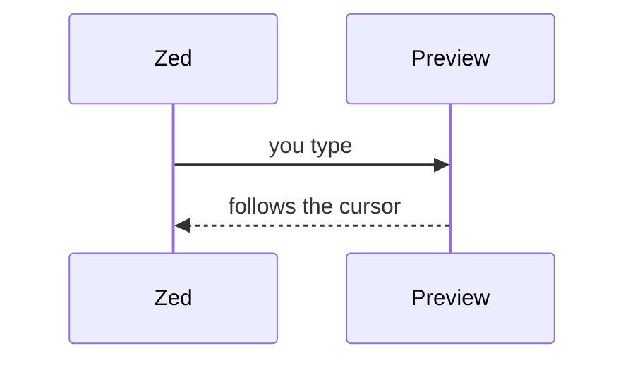
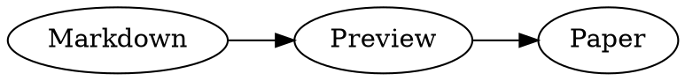

# Writing Markdown in Zed with MarkDown Live

*Manual for MarkDown Live 0.7.1.* Every example shows the Markdown you type, followed by
**Result:**, which is what the preview (and a printout) shows. Open this file in Zed and
press **Option-M**: the results below are drawn live by MarkDown Live, so you can change
an example and watch the result change.

[TOC]

## 1. Getting started

### 1.1 Your first document

1. In Zed, open a folder (**File → Open**, or `zed ~/Notes` in the Terminal).
2. Create a file whose name ends in **`.md`**, for example `notes.md` (**Cmd-N**, then
   **Cmd-S**). Zed now treats it as Markdown and starts MarkDown Live in the background.
3. Press **Option-M**. The preview opens in a browser window next to Zed.
4. Type. The preview follows as you type (also unsaved text) and scrolls to where
   your cursor is.

### 1.2 Keys in Zed

| Key | What it does |
|---|---|
| **Option-M** | open the preview of the current file |
| **Option-Shift-N** | insert a new slide marker `<!-- slide -->` at the cursor |
| **Option-Shift-P** | print the current file (opens the preview and the print dialog) |
| **Cmd-.** | MarkDown Live actions: open/refresh preview, insert slide, print, run code chunks |
| **Cmd-Shift-V** | Zed's own built-in Markdown preview (simpler, no diagrams) |

### 1.3 Keys and buttons in the preview

| Key | Button | What it does |
|---|---|---|
| **T** | ☰ (top left) | table of contents in a side bar |
| **S** | link icon | scroll sync on/off (preview follows the cursor in Zed) |
| **D** | sun icon | theme: from settings → light → dark |
| **+ / − / 0** | − 100% + | text size |
| **R** | ⟳ | re-render: re-read imported files, run code chunks again |
| **M** | KaTeX / MathJax | switch the math engine |
| **Cmd-P** | printer | print, or **Save as PDF** |

Clicking a link to another `.md` file opens it in the preview **and** in Zed. Clicking a
picture shows it full size (Esc closes).

## 2. Text

### 2.1 Headings

````markdown
# Heading 1
## Heading 2
### Heading 3
#### Heading 4
````

**Result:**

<div style="border:1px dashed #d1d9e0;border-radius:6px;padding:0 16px">

<p style="font-size:2em;font-weight:600;margin:.4em 0">Heading 1</p>
<p style="font-size:1.5em;font-weight:600;margin:.4em 0">Heading 2</p>
<p style="font-size:1.25em;font-weight:600;margin:.4em 0">Heading 3</p>
<p style="font-size:1em;font-weight:600;margin:.4em 0 .8em">Heading 4</p>

</div>

(Shown as a picture of the headings, so they don't end up in this manual's table of contents.)

### 2.2 Paragraphs and line breaks

A blank line starts a new paragraph. A single line break is ignored, unless you end the
line with two spaces or a backslash.

````markdown
First paragraph, written
on two lines.

Second paragraph.\
A forced line break.
````

**Result:**

First paragraph, written
on two lines.

Second paragraph.\
A forced line break.

### 2.3 Emphasis and inline styles

````markdown
**bold**, *italic*, ***both***, ~~strikethrough~~, ==highlight==,
`inline code`, H~2~O (subscript), E = mc^2^ (superscript)
````

**Result:**

**bold**, *italic*, ***both***, ~~strikethrough~~, ==highlight==,
`inline code`, H~2~O (subscript), E = mc^2^ (superscript)

### 2.4 Emoji

````markdown
:tada: :rocket: :white_check_mark: :warning: :+1:
````

**Result:**

:tada: :rocket: :white_check_mark: :warning: :+1:

### 2.5 Lists

````markdown
- apples
- pears
  - nested: indent by two spaces
1. first
2. second
3. third
````

**Result:**

- apples
- pears
  - nested: indent by two spaces

1. first
2. second
3. third

### 2.6 Task lists

````markdown
- [x] write the manual
- [ ] print it
````

**Result:**

- [x] write the manual
- [ ] print it

### 2.7 Definition lists

````markdown
Markdown
: A plain-text format that turns into formatted text.
````

**Result:**

Markdown
: A plain-text format that turns into formatted text.

### 2.8 Quotes

````markdown
> Simplicity is the ultimate sophistication.
> — Leonardo da Vinci
````

**Result:**

> Simplicity is the ultimate sophistication.
> — Leonardo da Vinci

### 2.9 Alerts and admonitions

GitHub-style alerts (NOTE, TIP, IMPORTANT, WARNING, CAUTION):

````markdown
> [!TIP]
> Press Option-M to open the preview.

> [!WARNING]
> Code chunks only run when you allow them.
````

**Result:**

> [!TIP]
> Press Option-M to open the preview.

> [!WARNING]
> Code chunks only run when you allow them.

Markdown Preview Enhanced style, with your own title (the body is indented 4 spaces):

````markdown
!!! note "Good to know"
    The preview also works for files that are not saved yet.
````

**Result:**

!!! note "Good to know"
    The preview also works for files that are not saved yet.

### 2.10 Horizontal line

````markdown
Above

---

Below
````

**Result:**

Above

---

Below

### 2.11 Footnotes

````markdown
MarkDown Live is built in Rust[^rust].

[^rust]: The preview server is a single program, `markdown-zed`.
````

**Result:**

MarkDown Live is built in Rust[^rust].

[^rust]: The preview server is a single program, `markdown-zed`.

(The footnote itself appears at the very end of this manual.)

### 2.12 Table of contents

Put `[TOC]` on a line of its own; it lists all headings and stays up to date. This manual
uses one at the top. Key **T** in the preview shows the same list in a side bar.

## 3. Links and pictures

### 3.1 Links

````markdown
[Zed](https://zed.dev), an autolink: https://example.com,
a link to a heading: [Tables](#4-tables),
and a link to another Markdown file: [the terminal manual](manual-terminal.md).
````

**Result:**

[Zed](https://zed.dev), an autolink: https://example.com,
a link to a heading: [Tables](#4-tables),
and a link to another Markdown file: [the terminal manual](manual-terminal.md).

### 3.2 Pictures

Paths are relative to the Markdown file. `{width=…}` sets the size (pixels or %).

````markdown
{width=160}
````

**Result:**

{width=160}

A picture alone in a paragraph, with a title in quotes, becomes a figure with a caption:

````markdown
{width=50%}
````

**Result:**

{width=50%}

Supported: png, jpeg, gif, bmp, svg, webp, avif, **heic/heif** and **tiff** (converted
automatically). Other options: `height=…`, `style="…"`, `.class`.

### 3.3 Videos and audio

Same syntax as pictures. mp4, webm, mkv, mov, avi … are played in the page (files the
browser can't play are converted in the background with ffmpeg). Options: `width`,
`autoplay`, `loop`, `muted`, `start=12` (seconds), `poster="cover.jpg"`.

````markdown
{width=360}


````

**Result:**

{width=360}


YouTube and Vimeo links become players: `` (loaded
from the internet). Printing leaves videos out and prints "▶ video: …" instead.

## 4. Tables

### 4.1 Markdown tables

`:---` aligns left, `:---:` centres, `---:` aligns right.

````markdown
| Fruit | Colour | Price |
|:------|:------:|------:|
| Apple | red    |  1.20 |
| Pear  | green  |  0.90 |
````

**Result:**

| Fruit | Colour | Price |
|:------|:------:|------:|
| Apple | red    |  1.20 |
| Pear  | green  |  0.90 |

### 4.2 Tables from a CSV file

The delimiter (`,` `;` tab `|`) is detected; numbers are aligned right.

````markdown
@import "../examples/data.csv" {caption="Quarterly sales"}
````

**Result:**

@import "../examples/data.csv" {caption="Quarterly sales"}

### 4.3 CSV written in the document

````markdown
```csv {delimiter=";" caption="Prices"}
product;price;stock
Apple;1,20;140
Pear;0,90;75
```
````

**Result:**

```csv {delimiter=";" caption="Prices"}
product;price;stock
Apple;1,20;140
Pear;0,90;75
```

Options: `delimiter=";"`, `header=false`, `caption="…"`, `maxRows=100`, and `chart="bar"`
(see 7.4).

## 5. Code

### 5.1 Code blocks

Put the language after the three backticks for colours. Options: `.line-numbers`,
`highlight=[2,4-5]`. A copy button appears when you hover over a block.

````markdown
```python {.line-numbers highlight=[2]}
def greet(name):
    return f"Hello, {name}!"

print(greet("Zed"))
```
````

**Result:**

```python {.line-numbers highlight=[2]}
def greet(name):
    return f"Hello, {name}!"

print(greet("Zed"))
```

### 5.2 Showing a file, or part of it

`as="text"` (or a language, like `as="python"`) shows a file as code; `line_begin` and
`line_end` pick the lines (counting from 0).

````markdown
@import "../examples/molecules/ethanol.xyz" {as="text" line_begin=0 line_end=4}
````

**Result:**

@import "../examples/molecules/ethanol.xyz" {as="text" line_begin=0 line_end=4}

`@import` also includes other Markdown files (`@import "chapter2.md"`), Mermaid files
(`.mmd`) and HTML.

## 6. Math and chemistry

### 6.1 Formulas

`$…$` inside a line, `$$…$$` on lines of their own (LaTeX syntax).

````markdown
Euler: $e^{i\pi} + 1 = 0$ and Pythagoras: $a^2 + b^2 = c^2$.

$$
\int_0^\infty e^{-x^2}\,dx = \frac{\sqrt{\pi}}{2}
\qquad
\begin{pmatrix} a & b \\ c & d \end{pmatrix}
$$
````

**Result:**

Euler: $e^{i\pi} + 1 = 0$ and Pythagoras: $a^2 + b^2 = c^2$.

$$
\int_0^\infty e^{-x^2}\,dx = \frac{\sqrt{\pi}}{2}
\qquad
\begin{pmatrix} a & b \\ c & d \end{pmatrix}
$$

KaTeX is the default; key **M** switches to MathJax for the rare formula KaTeX can't draw.

### 6.2 Chemical formulas and equations

`\ce{…}` for formulas and reactions, `\pu{…}` for units (mhchem).

````markdown
Water is $\ce{H2O}$, sulfate is $\ce{SO4^2-}$, and $\pu{123 kJ/mol}$.

$$
\ce{CO2 + C -> 2 CO}
\qquad
\ce{Zn^2+ <=>[+ 2OH-][+ 2H+] Zn(OH)2 v}
$$
````

**Result:**

Water is $\ce{H2O}$, sulfate is $\ce{SO4^2-}$, and $\pu{123 kJ/mol}$.

$$
\ce{CO2 + C -> 2 CO}
\qquad
\ce{Zn^2+ <=>[+ 2OH-][+ 2H+] Zn(OH)2 v}
$$

### 6.3 Molecules in 2D (SMILES)

One molecule per line: the SMILES code, then a name.

````markdown
```smiles
CCO ethanol
CC(=O)Oc1ccccc1C(=O)O aspirin
```
````

**Result:**

```smiles
CCO ethanol
CC(=O)Oc1ccccc1C(=O)O aspirin
```

### 6.4 Molecules in 3D (Mol*)

From a file (`.pdb`, `.cif`, `.sdf`, `.mol`, `.mol2`, `.xyz` …), or pasted into a block
whose language is the format. Drag to rotate, scroll to zoom. Options: `height`,
`title`, `spin=true`.

````markdown
@import "../examples/molecules/caffeine.sdf" {height=280 title="Caffeine"}

```xyz {height=220 title="Water"}
3
water
O 0.000 0.000 0.117
H 0.000 0.757 -0.469
H 0.000 -0.757 -0.469
```
````

**Result:**

@import "../examples/molecules/caffeine.sdf" {height=280 title="Caffeine"}

```xyz {height=220 title="Water"}
3
water
O 0.000 0.000 0.117
H 0.000 0.757 -0.469
H 0.000 -0.757 -0.469
```

```` ```molstar {pdb=1CRN} ```` (an empty block) downloads a protein from the Protein
Data Bank (internet needed).

## 7. Diagrams and charts

### 7.1 Mermaid

Flowcharts, sequence, class, state, ER and Gantt diagrams, pie charts, mind maps …

````markdown

````

**Result:**


````markdown

````

**Result:**


### 7.2 PlantUML

Drawn by PlantUML on your Mac (needs Java and PlantUML: `brew install plantuml`).

````markdown
```plantuml
Alice -> Bob : hello
Bob --> Alice : hi!
```
````

**Result:**

```plantuml
Alice -> Bob : hello
Bob --> Alice : hi!
```

Also `ditaa`, `salt`, `mindmap`, `gantt` and `wbs` blocks.

### 7.3 Graphviz

````markdown

````

**Result:**


### 7.4 Charts (Chart.js)

Straight from a CSV file:

````markdown
@import "../examples/data.csv" {chart="bar" title="Sales per region"}
````

**Result:**

@import "../examples/data.csv" {chart="bar" title="Sales per region"}

Or with a full Chart.js configuration:

````markdown
```chart
{
  type: 'line',
  data: {
    labels: ['Jan', 'Feb', 'Mar', 'Apr'],
    datasets: [{ label: 'Visitors', data: [120, 190, 170, 240] }]
  }
}
```
````

**Result:**

```chart
{
  type: 'line',
  data: {
    labels: ['Jan', 'Feb', 'Mar', 'Apr'],
    datasets: [{ label: 'Visitors', data: [120, 190, 170, 240] }]
  }
}
```

### 7.5 Vega-Lite

````markdown
```vega-lite
{
  "data": {"values": [{"a": "A", "b": 28}, {"a": "B", "b": 55}, {"a": "C", "b": 43}]},
  "mark": "bar",
  "encoding": {"x": {"field": "a", "type": "nominal"}, "y": {"field": "b", "type": "quantitative"}}
}
```
````

**Result:**

```vega-lite
{
  "data": {"values": [{"a": "A", "b": 28}, {"a": "B", "b": 55}, {"a": "C", "b": 43}]},
  "mark": "bar",
  "encoding": {"x": {"field": "a", "type": "nominal"}, "y": {"field": "b", "type": "quantitative"}}
}
```

### 7.6 Plotly

````markdown
```plotly
{
  data: [{ type: 'pie', labels: ['Writing', 'Previewing', 'Coffee'], values: [60, 25, 15] }],
  layout: { height: 320 }
}
```
````

**Result:**

```plotly
{
  data: [{ type: 'pie', labels: ['Writing', 'Previewing', 'Coffee'], values: [60, 25, 15] }],
  layout: { height: 320 }
}
```

### 7.7 Timing diagrams and flowcharts

````markdown
```wavedrom
{ signal: [{ name: 'clk', wave: 'p.....' }, { name: 'data', wave: 'x.34.x', data: ['A', 'B'] }] }
```

```flow
st=>start: Start
op=>operation: Write
e=>end: Done
st->op->e
```
````

**Result:**

```wavedrom
{ signal: [{ name: 'clk', wave: 'p.....' }, { name: 'data', wave: 'x.34.x', data: ['A', 'B'] }] }
```

```flow
st=>start: Start
op=>operation: Write
e=>end: Done
st->op->e
```

### 7.8 Kroki (other diagram languages, online)

For languages MarkDown Live doesn't draw itself (D2, BPMN, Nomnoml, Svgbob, Excalidraw …),
put `kroki-` before the language. The block is sent to kroki.io, so it needs the internet;
nothing else in your document is sent.

````markdown
```kroki-d2
Markdown -> Preview: live
```
````

To make a diagram smaller, wrap it in a `<div>` with a width (keep the empty lines):

````markdown
<div style="width:50%; margin:auto">

```kroki-d2
Markdown -> Preview: live
```

</div>
````

(No result here: this manual is also made into a PDF without internet access.)

## 8. Running code

### 8.1 Code chunks

Add `{cmd=true}` to a code block to run it; its output appears under it. For safety,
code only runs after you allow it: click **Run code chunks for this session** in the
yellow banner, or set `"enableScriptExecution": true` in Zed's settings (see 11).

````markdown
```python {cmd=true}
total = sum(range(1, 11))
print("1 + 2 + … + 10 =", total)
```
````

**Result:**

```python {cmd=true}
total = sum(range(1, 11))
print("1 + 2 + … + 10 =", total)
```

Python uses the `"python"` setting (or the `.venv` of your project). `bash`, `node`,
`ruby`, `Rscript`, `julia`, `php`, `lua` and `perl` run too.

### 8.2 Graphs with matplotlib — Graph / Diagram | Code

`plt.show()` puts the graph in the document. With `hide=true` you see the result in a
frame with two buttons: **Graph / Diagram** and **Code**.

````markdown
```python {cmd=true hide=true}
import matplotlib.pyplot as plt
x = list(range(11))
plt.plot(x, [v * v for v in x], marker="o")
plt.title("x squared")
plt.show()
```
````

**Result:**

```python {cmd=true hide=true}
import matplotlib.pyplot as plt
x = list(range(11))
plt.plot(x, [v * v for v in x], marker="o")
plt.title("x squared")
plt.show()
```

Plotly's `fig.show()` gives an interactive chart the same way.

### 8.3 Output as Markdown

`output=markdown` treats what the code prints as Markdown (`html` and `none` also exist).
Useful for tables, or for pictures your code saves:

````markdown
```python {cmd=true hide=true output=markdown}
rows = [("Apple", 3), ("Pear", 5)]
print("| Fruit | Count |\n|---|---:|")
for name, n in rows:
    print(f"| {name} | {n} |")
```
````

**Result:**

```python {cmd=true hide=true output=markdown}
rows = [("Apple", 3), ("Pear", 5)]
print("| Fruit | Count |\n|---|---:|")
for name, n in rows:
    print(f"| {name} | {n} |")
```

For libraries that write a picture file, such as `diagrams`, save it as PNG with
`show=False` and print an image tag:

````markdown
```python {cmd=true output=markdown hide=true}
from diagrams import Diagram
from diagrams.aws.compute import EC2
with Diagram("Web", filename="web", outformat="png", show=False):
    EC2("server")
print('')
```
````

### 8.4 Errors

Errors are shown under the code, with only the lines of your own code:

````markdown
```python {cmd=true}
x = 1 / 0
```
````

**Result:**

```python {cmd=true}
x = 1 / 0
```

Press **R** in the preview to run all chunks again (for example after changing a file
they read).

## 9. Slides and notes

A marker `<!-- slide -->` (**Option-Shift-N**) starts a new slide. Every slide is shown
in a numbered frame; its **notes** go under it. Notes start with a line `Note:` and run
to the next marker. The content before the first marker is the first slide. A marker can
set a background colour: `<!-- slide data-background-color="#fff8c5" -->`.

<div style="border:1px dashed #d1d9e0;border-radius:6px;padding:12px 16px">

````markdown
## Our plan

- write the manual
- print it

Note:
Mention that printing in landscape puts the notes on a separate page.

<!-- slide data-background-color="#eef6ff" -->
## Questions?
````

</div>

**Result** (a document with markers):

<div style="break-inside:avoid-page">
<div style="border:1.5px solid #59636e;border-radius:6px;aspect-ratio:16/9;padding:24px 36px;display:flex;flex-direction:column;justify-content:center;position:relative;max-width:520px">
<p style="font-size:1.5em;font-weight:600;margin:0 0 12px">Our plan</p>
<ul style="margin:0"><li>write the manual</li><li>print it</li></ul>
<span style="position:absolute;right:12px;bottom:6px;font-size:12px;color:#59636e">1</span>
</div>
<div style="margin:10px 0 20px;padding:8px 12px;border-left:3px solid #d1d9e0;color:#59636e;font-size:14px;max-width:520px"><b style="color:#1f2328">Note:</b><br>Mention that printing in landscape puts the notes on a separate page.</div>
<div style="border:1.5px solid #59636e;border-radius:6px;aspect-ratio:16/9;padding:24px 36px;display:flex;flex-direction:column;justify-content:center;position:relative;max-width:520px;background:#eef6ff">
<p style="font-size:1.5em;font-weight:600;margin:0">Questions?</p>
<span style="position:absolute;right:12px;bottom:6px;font-size:12px;color:#59636e">2</span>
</div>
</div>

(Drawn here with HTML, because this manual itself has no slide markers.)

**Printing slides:** in **portrait**, every page has one slide with "Note:" and the
notes under it; in **landscape**, the slide fills the page and its notes are printed on
the next page. Choose the orientation in the print dialog. See `examples/v4-slides.md`.

## 10. Printing and PDF

- **Cmd-P** in the preview, the printer button, **Option-Shift-P** in Zed, or
  `markdown-zed print file.md` in the Terminal.
- The print dialog of your browser opens. Choose a printer, or **Save as PDF**.
- The printout is always light (also when the preview is dark), without the toolbar.
  Charts, 3D molecules and `hide=true` chunks are printed as their result; videos are
  left out.
- Diagrams are never wider than the page. A very tall diagram can be made smaller with
  the `<div style="width:…">` wrapper shown in 7.8.

## 11. Settings

Settings live in Zed's settings file (**Cmd-,** opens it), under `lsp` → `markdown-live`:

````jsonc
{
  "lsp": {
    "markdown-live": {
      "binary": { "path": "/Users/you/.cargo/bin/markdown-zed" },
      "settings": {
        "enableScriptExecution": true,              // run {cmd=true} chunks without asking
        "python": "/Users/you/.venvs/myenv/bin/python3",
        "theme": "auto",                            // auto | light | dark
        "math": "katex",                            // katex | mathjax
        "plantumlJar": "/opt/homebrew/opt/plantuml/libexec/plantuml.jar",
        "java": "/opt/homebrew/opt/openjdk/bin/java",
        "frontMatter": "none",                      // none | table | code
        "breaks": false                             // true: every line break counts
      }
    }
  }
}
````

After changing settings, run **editor: restart language server** in Zed (Cmd-Shift-P).
All settings are listed in the README.

## 12. Front matter

A block between `---` lines at the very top holds information about the document. Its
`title` becomes the window title of the preview (and the file name when you save as PDF).

````markdown
---
title: My report
author: Kris
---
# My report
````

With `"frontMatter": "table"` it is also shown as a table.

## 13. When something doesn't work

| What you see | What to do |
|---|---|
| Option-M does nothing | run `markdown-zed setup-zed` in the Terminal, restart Zed |
| "code execution is off" | click the button in the yellow banner, or set `"enableScriptExecution": true` |
| `ModuleNotFoundError` in a chunk | install the package in the Python of your `"python"` setting: `…/python3 -m pip install name` |
| footer shows **standalone** | close the preview tab, run `pkill -f "markdown-zed serve"`, restart the language server, Option-M |
| PlantUML: "needs Java" | `brew install plantuml` |
| a video stays on "Converting…" | `brew install ffmpeg` |
| 3D molecule: "WebGL turned off" | turn on graphics acceleration in the browser settings |
| attribute ignored, e.g. `output=“markdown”` | write the quotes again by hand, or leave them out: `output=markdown` |

`markdown-zed doctor` in the Terminal shows what MarkDown Live found on your Mac (see the
terminal manual).
