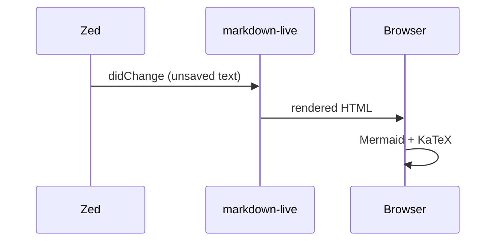
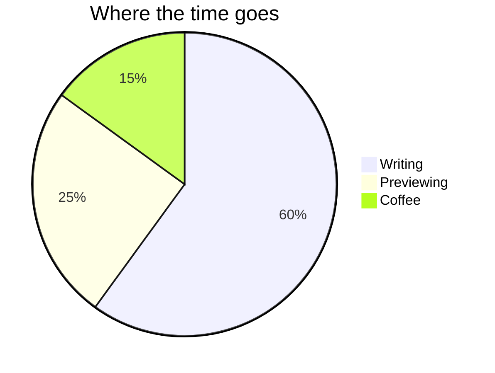

# MarkDown Live — core features

Open this file in Zed and press **Option-M** (Alt-M on Linux). Edit anything: the
preview follows as you type, and scrolls to where your cursor is.

[TOC]

## Markdown

**Bold**, *italic*, ~~strikethrough~~, ==highlight==, H~2~O, E = mc^2^, `inline code`,
:tada: emoji shortcodes, footnotes[^1], [links](https://zed.dev) and autolinks: https://example.com.

- [x] task lists
- [ ] with checkboxes

Term
: Definition lists

| Left | Center | Right |
|:-----|:------:|------:|
| a    |   b    |     1 |
| c    |   d    |    22 |

> [!NOTE]
> GitHub alerts: NOTE, TIP, IMPORTANT, WARNING, CAUTION.

!!! tip "MPE admonitions"
    `!!! type "title"` with an indented body, as in Markdown Preview Enhanced.

[^1]: Footnotes are collected at the end.

## Math (KaTeX)

Inline: $e^{i\pi} + 1 = 0$, also \(a^2 + b^2 = c^2\).

$$
\mathbf{F} = m\,\mathbf{a} \qquad \oint_{\partial\Sigma} \mathbf{B}\cdot d\mathbf{l} = \mu_0 I
$$

```math
\begin{pmatrix} a & b \\ c & d \end{pmatrix}^{-1} = \frac{1}{ad-bc}\begin{pmatrix} d & -b \\ -c & a \end{pmatrix}
```

## Mermaid





## CSV tables

A file next to this document:

@import "data.csv" {caption="Quarterly sales"}

Or inline, with any delimiter (auto-detected, or `delimiter=";"`):

```csv {delimiter=";" caption="Prices"}
product;price;stock
Apple;1,20;140
Pear;0,90;75
"Kiwi; gold";2,10;12
```

## Code

```rust {.line-numbers highlight=[2]}
fn main() {
    println!("Hello from MarkDown Live");
}
```

@import "data.csv" {as="text" line_begin=0 line_end=2}

## Images and links


Links to other Markdown files open them in the preview (and in Zed): [back to the top](#markdown-live--core-features).
