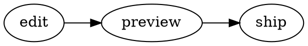

# MarkDown Live — diagrams, charts, chemistry and code (0.2.0)

Everything below renders offline. PlantUML uses your local Java + plantuml.jar
(`brew install plantuml`, or the jar PlantUML Live downloaded). Code chunks only
run after you allow them (banner at the top, or `"enableScriptExecution": true`).

[TOC]

## PlantUML

```plantuml
Alice -> Bob : hello
Bob --> Alice : hi
```

## Graphviz



```neato
graph { a -- b -- c -- a }
```

## Vega-Lite

```vega-lite
{
  // relaxed JSON: comments, unquoted keys, trailing commas
  $schema: "https://vega.github.io/schema/vega-lite/v5.json",
  data: { url: "data.csv" },
  mark: "bar",
  encoding: { x: { field: "region", type: "nominal" }, y: { field: "q1", type: "quantitative" }, },
}
```

## WaveDrom

```wavedrom
{ signal: [ { name: "clk", wave: "p......" }, { name: "dat", wave: "x.345x.", data: ["a", "b", "c"] } ] }
```

## flowchart.js

```flow
st=>start: Start
op=>operation: Write
cond=>condition: Done?
e=>end: End
st->op->cond
cond(yes)->e
cond(no)->op
```

## Chart.js

```chart
{
  type: "line",
  data: { labels: ["Jan", "Feb", "Mar"], datasets: [{ label: "Visits", data: [3, 7, 4] }] },
}
```

@import "data.csv" {chart="bar" title="Sales per region"}

## Plotly

```plotly
{ "data": [{ "x": [1, 2, 3], "y": [2, 1, 3], "type": "scatter" }], "layout": { "title": { "text": "Plotly" } } }
```

## Math engines

Press **M** (or the KaTeX/MathJax button) to switch engines. MathJax supports more
LaTeX (`\begin{align}`, `\require`, …):

$$
\begin{aligned}
\nabla \cdot \mathbf{E} &= \frac{\rho}{\varepsilon_0} \\
\nabla \times \mathbf{B} - \mu_0\varepsilon_0 \frac{\partial \mathbf{E}}{\partial t} &= \mu_0 \mathbf{J}
\end{aligned}
$$

## Chemistry

Water: $\ce{H2O}$, reaction: $\ce{CO2 + C -> 2 CO}$, units $\pu{123 kJ/mol}$.

$$
\ce{Zn^2+ <=>[+ 2OH-][+ 2H+] $\underset{\text{amphoteric hydroxide}}{\ce{Zn(OH)2 v}}$}
$$

```smiles
CCO ethanol
c1ccccc1 benzene
CC(=O)Oc1ccccc1C(=O)O aspirin
```

## Python

With `hide=true` the result is shown in a frame with two buttons: **Graph / Diagram**
(the result) and **Code** (the code that made it).

```python {cmd=true hide=true}
import matplotlib.pyplot as plt
print("sum =", sum(range(10)))
plt.plot([1, 4, 9, 16])
plt.title("squares")
plt.show()
```

```python {cmd=true hide=true output=markdown}
print("| a | b |\n|---|---|\n| 1 | 2 |")
```

```python {cmd=true hide=true}
import plotly.express as px
fig = px.bar(x=["a", "b", "c"], y=[1, 3, 2])
fig.show()
```

Errors are shown under the chunk:

```python {cmd=true}
raise RuntimeError("expected failure")
```

Other languages run too (`bash`, `node`, `ruby`, `Rscript`…):

```bash {cmd=true}
echo "Hello from $(uname -s)"
```

## Kroki (online, only when you ask for it)

````markdown
```kroki-d2
x -> y: hello
```
````
