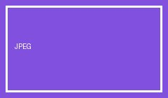

# MarkDown Live — pictures, videos and audio (0.3.0)

Pictures use the normal Markdown syntax; size them with `{width=300}`. A picture
alone in its paragraph with a title (`"…"`) gets a caption. HEIC and TIFF are
converted for the browser (`sips` on macOS). Videos use the same syntax:
MKV/AVI/… are converted with ffmpeg in the background, then cached.

## Pictures

 {width=120}  

 

@import "media/pic.heic" {width=200 title="imported HEIC"}

## Videos

{width=240}

@import "media/clip.mp4" {autoplay loop start=1}

## Audio and embeds

