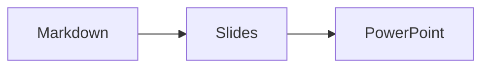

# Slides and printing

Made with **MarkDown Live**. Press **P** in the preview for the slide view,
**Cmd-P** to print (in the slide view: one slide per page), and **Option-Shift-N**
in Zed to insert a new slide.

<aside class="notes">Say hello first.</aside>

<!-- slide -->
## A diagram



<!-- slide -->
## Math and chemistry

$$
e^{i\pi} + 1 = 0
$$

Water is $\ce{H2O}$ and $\frac{a}{b}$ is a fraction.

<!-- slide vertical=true -->
### A vertical slide

- one
- two

<!-- slide data-background-color="#fff8c5" -->
## Table and picture

@import "data.csv"


<!-- slide -->
## Code

```python
def hello():
    return "world"
```
