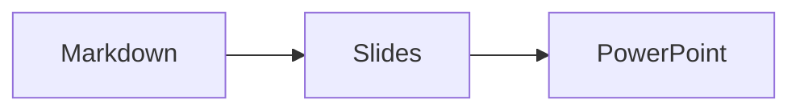

# Slides and printing

Made with **MarkDown Live**. Each `<!-- slide -->` marker starts a new slide
(**Option-Shift-N** in Zed inserts one). Print with **Cmd-P**: in portrait every page
has a slide with its notes under it, in landscape the notes go on the next page.

Note:
Say hello first. Everything after "Note:" until the next slide is the note.

<!-- slide -->
## A diagram



<!-- slide -->
## Math and chemistry

$$
e^{i\pi} + 1 = 0
$$

Water is $\ce{H2O}$ and $\frac{a}{b}$ is a fraction.

<!-- slide vertical=true -->
### A vertical slide

- one
- two

<!-- slide data-background-color="#fff8c5" -->
## Table and picture

@import "data.csv"


<!-- slide -->
## Code

```python
def hello():
    return "world"
```
