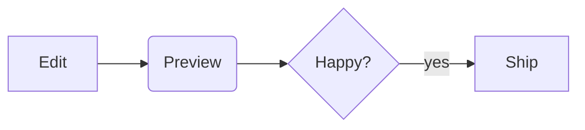

# MarkDown Live demo

[TOC]

## Text

Some **bold**, *italic*, ~~strike~~, ==mark==, H~2~O, x^2^, `code` and :rocket:.

> [!TIP]
> GitHub alerts work.

!!! warning "Careful"
    MPE admonitions too.

## Math

Inline $E = mc^2$ and display:

$$
\int_0^\infty e^{-x^2}\,dx = \frac{\sqrt{\pi}}{2}
$$

## Mermaid



## CSV

@import "data.csv" {caption="Sales"}

```csv {delimiter=";"}
product;price
Apple;1,20
Pear;0,90
```

## Code

```rust {.line-numbers highlight=2}
fn main() {
    println!("hello");
}
```

## Links

See the [other page](other.md) and the .
